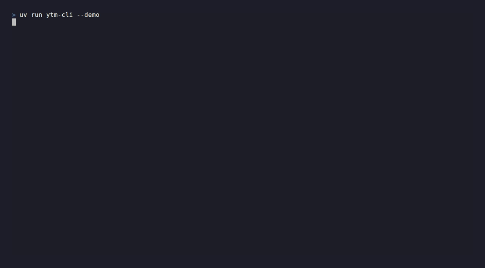

# YTM - YouTube Music CLI

🎵 **A simple, interactive command-line tool for YouTube Music**

Stream music directly from YouTube Music in your terminal with intuitive controls, playlist management, and smart filtering.

<p align="center">
  <a href="https://github.com/thieuluan1618/ytm/raw/main/screenshots/player.webm">
    
  </a>
</p>

<p align="center">
  <em>Player UI with the real-time FFT spectrum visualizer (synthetic demo capture).
  Click for the higher-quality .webm.</em>
</p>

## ✨ Features

- **🔍 Smart Search**: Search and play any song from YouTube Music
- **🎮 Interactive Controls**: Play/pause, skip, go back with simple key presses
- **📱 Vim-like Navigation**: Use `j/k` keys or arrow keys to navigate
- **♥ Local Favorites**: Toggle favorite songs instantly with `f`
- **📋 Local Playlists**: Create and manage personal playlists
- **👎 Smart Filtering**: Dislike songs to filter them from future results
- **📜 Synced Lyrics**: Live-highlighted lyrics with auto-scroll (press `l`)
- **🎯 Radio Mode**: Automatic playlist generation based on your selection
- **📊 Real-time Spectrum Visualizer**: 24-band FFT bars in both player layouts, driven by an `ffmpeg` sidecar with animated fallback bars when live data is unavailable
- **🤖 AI-Powered**: Natural language music requests and AI-generated playlists

## 🚀 Quick Start

### Requirements

- **macOS** (the only platform maintained for now)
- Python **3.10+** (set in `pyproject.toml`)
- [mpv media player](https://mpv.io/installation/), installed system-wide: `brew install mpv`
- [`ffmpeg`](https://ffmpeg.org/) on `PATH` for the real-time spectrum visualizer: `brew install ffmpeg` (optional — falls back to animated bars if missing)

### Installation

**One command with [uv](https://docs.astral.sh/uv/) (recommended):**

```bash
# Install from PyPI — gets latest version automatically
uvx ytm-cli "song name"
```

<details>
<summary>Alternative: clone and run locally</summary>

```bash
git clone https://github.com/thieuluan1618/ytm.git
cd ytm
uv run ytm-cli "song name"
```

</details>

<details>
<summary>Alternative: one-shot setup script (macOS)</summary>

```bash
git clone https://github.com/thieuluan1618/ytm.git
cd ytm
./setup.sh
source ~/.zshrc            # or ~/.bashrc for bash
```

This creates the venv, installs runtime deps from `pyproject.toml`, and adds a `ytm` shell alias.

</details>

<details>
<summary>Alternative: manual install</summary>

```bash
git clone https://github.com/thieuluan1618/ytm.git
cd ytm
uv sync                   # installs runtime deps from pyproject.toml + uv.lock
./setup_alias.sh          # optional: registers the `ytm` alias
# Run with: uv run ytm-cli "song"
```

</details>

> **Platform support:** macOS is the only platform maintained for now. Linux and WSL2 may still work but aren't maintained. Native Windows is not supported (the codebase uses POSIX-only `termios`/`tty`/`fcntl`).

### Basic Usage

**Interactive search:**

```bash
ytm-cli
# Enter search query when prompted
```

**Direct search:**

```bash
ytm-cli "your favorite song"
```

**Non-interactive mode (automation/scripting):**

```bash
ytm-cli search "song name" --select 1                     # Auto-select first result
ytm-cli search "song" -s 1 --verbose                      # With verbose output
ytm-cli search "song" -s 1 --verbose --log-file debug.log # Save debug logs
ytm-cli -v                                                # Print version
ytm-cli --update                                          # Update the app and dependencies
```

> **Tip:** Set up the shell alias to use `ytm` as a shortcut for `ytm-cli`. See the setup scripts above.

## 🎮 Controls

### During Song Selection

- `↑/↓` or `j/k` - Navigate through results
- `Enter` - Select and play song
- `f` - Add to or remove from Favorites
- `a` - Add to a playlist
- `q` - Quit

### During Playback

- `Space` - Play/pause
- `n` - Next song
- `p` - Previous song
- `l` - Show lyrics (synced highlighting with auto-scroll)
- `o` - Toggle floating desktop lyrics (macOS with mpv)
- `f` - Add to or remove from Favorites
- `a` - Add to playlist
- `d` - Dislike song (skip and filter from future results)
- `q` - Quit

### During Lyrics View

- `j/k` or `↑/↓` - Manual scroll
- `Space` - Re-enable auto-scroll
- `q` or `Esc` - Back to player
- `PgUp/PgDn` - Page scroll
- `Home/End` - Jump to top/bottom

### macOS Desktop Lyrics

Press `o` **in the terminal player** to show or hide a floating, click-through lyrics panel above other apps. By default, it shows only the current lyric at the top center of the display, below the menu bar, without stealing keyboard focus or interrupting playback. Both Rich and curses playback support it; `l` still opens the terminal lyrics viewer.

- Requires **mpv** playback and **Apple Command Line Tools** (`xcode-select --install` if missing).
- The small native AppKit helper compiles in the background on first use and is cached in `~/Library/Caches/ytm-cli/`. No extra Python dependencies or Accessibility permission are needed.
- Lyrics follow mpv's playback position, including pause and seek, and refresh automatically when the track changes.
- Songs with only plain lyrics or no matching synced lyrics show **“No synced lyrics available”** for 3 seconds, then fade out over 0.4 seconds; no timing is invented. Normal synced lyrics stay visible.
- The overlay starts off each session and closes when playback exits. `o` is a terminal shortcut, not a system-wide hotkey.
- The window is configured to join Spaces and fullscreen spaces, but visibility above other apps' fullscreen windows depends on macOS window management.

To also preview the next lyric, add this setting under `[ui]` in `~/.config/ytm-cli/config.ini`, then restart playback:

```ini
[ui]
lyrics_overlay_show_next_line = true
```

The default is `false` (current lyric only). This controls lyric entries, not text wrapping: a long current lyric can still wrap for readability.

## 📋 Playlist Management

**Create and manage playlists:**

```bash
ytm-cli playlist list              # List all playlists
ytm-cli playlist create            # Create new playlist
ytm-cli playlist show "My Songs"   # View playlist contents
ytm-cli playlist play "My Songs"   # Play entire playlist
ytm-cli playlist delete "My Songs" # Delete playlist
```

**Add songs to playlists:**

- Press `a` during song selection or playback
- Choose existing playlist or create new one
- Song added without interrupting playback

**Favorite songs:**

- Press `f` during song selection or playback to toggle a favorite
- The local `Favorites` playlist is created automatically on first use
- Play favorites with `ytm-cli playlist play Favorites`
- Favoriting a song clears its global dislike; globally disliking a song removes it from Favorites
- During local playlist playback, `d` first removes the song from that playlist; press it again to globally dislike and skip the song

## 🤖 AI Music Assistant

Use natural language to search and create playlists powered by AI (supports Google Gemini, OpenAI, Anthropic):

```bash
ytm-cli llm ask "play something chill for studying"       # AI picks and auto-plays
ytm-cli llm ask "upbeat pop songs for a workout"           # Natural language search
ytm-cli llm playlist "lo-fi beats for rainy days" --play   # AI-generated playlist
ytm-cli llm playlist "90s rock classics" -n 20             # 20-song playlist
```

Configure your provider in `config.ini`:

```ini
[llm]
provider = google       # google, openai, or anthropic
model = gemini-2.5-pro
```

## 🛠️ Configuration

The app uses `config.ini` for customization:

```ini
[general]
songs_to_display = 10
show_thumbnails = true

[mpv]
# Add custom mpv flags
flags = --no-video

[playlists]
directory = playlists
```

## 🎯 Philosophy

**Keep it simple for the listener to enjoy music.** Features are designed to be:

- **Intuitive**: Single-key shortcuts during playback
- **Non-disruptive**: Actions don't interrupt your listening experience
- **Consistent**: Same navigation patterns across all screens
- **Quick**: Important features accessible with simple key presses

## 🐛 Troubleshooting

Having issues? Check out the [**Troubleshooting Guide**](TROUBLESHOOTING.md) for solutions to common problems:

- 🔧 [Songs Skipping Continuously](TROUBLESHOOTING.md#songs-skipping-continuously)
- 📦 [MPV Not Found](TROUBLESHOOTING.md#mpv-not-found)
- 💻 [Terminal/Curses Errors](TROUBLESHOOTING.md#terminalcurses-errors)
- 📝 [Using Verbose Logging](TROUBLESHOOTING.md#using-verbose-logging)

**Quick diagnosis:**

```bash
# Enable verbose logging to see what's happening
ytm-cli search "test" -s 1 --verbose --log-file debug.log

# Check versions
mpv --version
yt-dlp --version
```

## 📄 License

This project is open source. Please check the license file for details.

---

**Enjoy your music! 🎵**
